# Rules for changing coroner

These rules apply to anyone changing coroner, human or agent. This file holds rules and
where to find things, not tutorials.

coroner is a Go CLI that records root-cause investigation timelines, with their events,
annotations and sources, in one SQLite file. Commands are noun-verb (`coroner event add`),
and exports are the only sharing contract.

## How to work here

Tasks live in [`.mise/tasks/`](.mise/tasks/); `mise tasks` lists them.

- `mise run setup` installs the pinned tools and Go modules and registers the git hooks.
- `mise run build` builds the binary into `bin/`.
- `mise run format` runs every formatter in write mode, plus `go mod tidy`,
  `sqlc generate`, the CLI reference generator and the export schema generator.
- `mise run lint` runs the linters without writing, then fails if the CLI reference or the
  export schema is stale. It does not check YAML, TOML, shell, Pkl or Python formatting,
  `go mod tidy` or `sqlc generate`; only `mise run format` and `pre-commit` apply those.
- `mise run test` runs the Ginkgo suites, and through them the testscript end-to-end
  scripts and the rapid properties; a package pattern narrows it, and `--focus <regexp>`
  narrows Ginkgo specs only, so plain `Test*` functions such as `TestScripts` still run.
- `mise run docs:serve` serves the docs site locally and rebuilds it on change.
  `mise run docs:build` builds it into `site/` with Zensical through `uv`, failing on any
  warning, such as a broken link between pages, copies the export schema in, and fails
  when a page links a file under `/coroner/schema/` that is not in `site/`.
- `mise run preflight` runs lint, test, build and docs:build. It is the gate before
  declaring work done (Rule 6).
- `mise run release:check` validates [`.goreleaser.yaml`](.goreleaser.yaml), and
  `mise run release:snapshot` builds every release artifact into `dist/` without
  publishing. `/release-coroner` runs `release:check` and `release:snapshot` as release
  gates, and [the releasing guide](docs/contributing/releasing.md) describes the flow.

The [`hk.pkl`](hk.pkl) hooks run on their own: `pre-commit` runs every formatter and
linter and applies fixes, regenerating the CLI reference when a help topic or the Go code
it documents changes, and the export schema when the export types change; and `pre-push`
runs `mise run test` when Go files, `go.mod` or `go.sum` change.

CI ([`.github/workflows/ci.yml`](.github/workflows/ci.yml)) runs on every pull request and
push to `main`: `mise run lint`, `mise run test`, `mise run docs:build`, then
`mise run format` failing on any diff, so a commit made with `--no-verify` still gets a
red check. The docs gate
([`.github/workflows/docs-gate.yml`](.github/workflows/docs-gate.yml)) fails a pull
request that changes a file under `internal/cli/` other than a test, testdata or help
topic without changing a page under `docs/` outside `docs/reference/cli/`, unless it has
the `docs-not-needed` label; [`.github/scripts/docs-gate`](.github/scripts/docs-gate)
holds the rule and reads changed paths on stdin, and
[`.github/scripts/docs-gate-test`](.github/scripts/docs-gate-test) checks its cases before
the gate runs. Pushing a `v*` tag runs two workflows: one deploys the docs site to GitHub
Pages ([`.github/workflows/docs.yml`](.github/workflows/docs.yml)), and the release
workflow ([`.github/workflows/release.yml`](.github/workflows/release.yml)) reads the
release notes from the annotated tag's message, then has goreleaser publish the release
and update the Homebrew cask.

## Routing

Read the digraph as a checklist, not a single path:
**load every file whose edge matches the change** before editing that area. A box marked
"not in the repo yet" names the issue that will land that file. Until it lands there is
nothing to load: skip the box, and never create its file early.

```graphviz
digraph coroner_rules_router {
    "Working on coroner" [shape=doublecircle];
    "What does the change touch?" [shape=diamond];

    "Load AGENTS.md § Rules" [shape=box];
    "Load docs/contributing/command-checklist.md" [shape=box];
    "Load .golangci.yml" [shape=box];
    "Load CONTEXT.md" [shape=box];
    "Load STABILITY.md" [shape=box];
    "Load skills/coroner/SKILL.md" [shape=box];
    "Load rules/documentation.md" [shape=box];
    "Load rules/timeline.md" [shape=box];
    "Load rules/store.md" [shape=box];
    "Load rules/timeparse.md" [shape=box];
    "Load rules/timetext.md" [shape=box];
    "Load rules/export.md" [shape=box];
    "Load rules/viewer.md" [shape=box];
    "Load rules/skills.md" [shape=box];
    "Load .claude/skills/release-coroner/SKILL.md" [shape=box];

    "Working on coroner" -> "What does the change touch?";
    "What does the change touch?" -> "Load AGENTS.md § Rules" [label="any change: the repository rules always apply"];
    "What does the change touch?" -> "Load docs/contributing/command-checklist.md" [label="a command, flag, output or error message (Rule 1)"];
    "What does the change touch?" -> "Load .golangci.yml" [label="Go code: function shape and layering are lint rules"];
    "What does the change touch?" -> "Load CONTEXT.md" [label="naming something in code, flags, JSON or docs"];
    "What does the change touch?" -> "Load STABILITY.md" [label="JSON output, exports or another contract (Rule 3)"];
    "What does the change touch?" -> "Load skills/coroner/SKILL.md" [label="a command, flag, JSON key, exit code or experimental surface the agent skill or its references name (Rule 5)"];
    "What does the change touch?" -> "Load rules/documentation.md" [label="adding, removing, renaming or changing a doc, a mise task, hk hook or CI workflow step, a rules/ file or a generated artifact; an area's first rules; landing anything marked not in the repo yet; or user-visible behaviour (Rule 4)"];
    "What does the change touch?" -> "Load rules/timeline.md" [label="internal/timeline, or code that stores, orders or validates its types"];
    "What does the change touch?" -> "Load rules/store.md" [label="internal/store: a migration, a query, sqlc.yaml, the SQL it runs, or the store's transactions and row mapping"];
    "What does the change touch?" -> "Load rules/timeparse.md" [label="internal/timeparse, or code that turns typed time input into an instant"];
    "What does the change touch?" -> "Load rules/timetext.md" [label="internal/timetext, or code that shows an event's time to people"];
    "What does the change touch?" -> "Load rules/export.md" [label="internal/export, schema/, testdata/export/, or code that encodes the export types, reads export JSONL or renders the Markdown, Mermaid, HTML or SVG export"];
    "What does the change touch?" -> "Load rules/viewer.md" [label="internal/viewer, or the code in internal/cli that loads what it shows"];
    "What does the change touch?" -> "Load rules/skills.md" [label="skills/: the agent skill, its references, skills/skills.go or .claude-plugin/marketplace.json"];
    "What does the change touch?" -> "Load .claude/skills/release-coroner/SKILL.md" [label="internal/tools/release: a subcommand, flag, JSON key or error code the /release-coroner skill uses"];
}
```

## Where things live and what to call them

- Commands: `internal/cli`. Store: `internal/store`. Domain types: `internal/timeline`.
  Typed time input: `internal/timeparse`. How an event's time reads to people:
  `internal/timetext`. Config file, XDG paths and precedence, and the attachment blob
  directory beside the database: `internal/config`, whose spec fails when
  [`docs/reference/configuration.md`](docs/reference/configuration.md) misses a key the
  config file accepts. JSON export types, envelope, encoder and JSONL decoder, and the
  Markdown, Mermaid, HTML and SVG exports' renderers: `internal/export`, the JSON
  described by [the export format reference](docs/reference/export-format.md); the HTML
  page's viewer and vendored vis-timeline live in `internal/export/html/`, its colour
  tokens in `internal/export/theme.go`, and the SVG picture's template in
  `internal/export/svg/`. The terminal viewer `timeline view` opens and the picker
  `timeline list` opens: `internal/viewer`. Which terminals show images inline, the Kitty
  graphics sequences and the placeholder text shown where none can: `internal/graphics`,
  pure. `main.go` builds `cli.App` from the process; code below it takes everything from
  `cli.App`, never from `os`. Dev tools run with `go run`: `internal/tools/` (`docgen`
  writes the CLI reference, and with `--man <dir>` the man pages a release packs;
  `schemagen` the export schema; `compatfixture` a release's fixture database; `release`
  the deterministic steps of `/release-coroner`, plus the release workflow's `tag-notes`
  step). [`.claude/skills/release-coroner/`](.claude/skills/release-coroner/SKILL.md) is
  the maintainer-only project skill that cuts a release; it ships neither with `skills/`
  nor in the marketplace.
- Help topics: `internal/cli/topics/<topic>.md`, embedded and printed as-is by
  `coroner help <topic>`, and copied into the CLI reference by `docgen`; those pages are
  also the site's reference pages for the topics. Specs fail when `exit-codes` disagrees
  with the exit-code map or `environment` misses an environment variable the code reads.
  The `reference` topic is not a file: `writeReference`
  ([`reference.go`](internal/cli/reference.go)) renders it from the command tree, so
  `docgen` writes no page for it.
  [`help-reference.txtar`](internal/cli/testdata/script/help-reference.txtar) pins the
  page, and any command or flag change rewrites it.
- Global flags and environment: `readInvocation`
  ([`invocation.go`](internal/cli/invocation.go)) reads them once at the top of a RunE,
  and resolves `--tz` only when a command asks for the zone. `agent skill`, `version`,
  shell completion and `errorStyleFor`, which runs when cobra failed to parse, never call
  it, so a malformed config file cannot break them.
- Errors and exit codes: a command's hooks or body return a `*cli.Error` whose `Kind`
  picks the exit code; `exitCodes` in [`internal/cli/errors.go`](internal/cli/errors.go)
  is the table. A domain validation problem becomes an exit kind in one table, `kindOf` in
  [`internal/cli/validation.go`](internal/cli/validation.go); commands turn a record's
  `Validate` error into an `*Error` with `recordError`, and `storeError` routes a
  store-side `*timeline.ValidationError` through it. Any other error, or a panic, exits 1
  as `internal`. A command declares the output formats it supports in its `formats`
  annotation, and any other `--format` or `--json` exits 2 as `usage`. `-t` names one
  timeline, and naming more exits 2 as `usage`, unless the command reads several, as
  `event list`, `timeline export`, `timeline view` and `overlay create` do. A command that
  reads `-t`, `--overlay`, `CORONER_TIMELINE` or the current timeline selects only through
  [`selection.go`](internal/cli/selection.go): `readTimelineInput` reads the command line
  before the store opens (from `wrapRunErrors` and `readInvocation`), `timelineInputOf`
  builds the same input from a write command's or form's fields, and `selectTimelines`
  selects against the store. A command declares how many timelines it reads in its
  `timelines` annotation (`several`, `positional`, `guard`), and the formats that print
  only one in its `oneTimelineFormats` annotation. `event list` and `timeline export` also
  take `--overlay`, a saved overlay's name, in place of `-t`, and read their events
  through `store.EventFilter.TimelineIDs`. `cli.Run` prints every error once, adding the
  JSON error envelope under `--format json|jsonl`.
- Deprecating a command or flag: `deprecateCommand` and `deprecateFlag` in
  [`internal/cli/deprecation.go`](internal/cli/deprecation.go), under the process in
  [`STABILITY.md`](STABILITY.md#deprecation).
  [`deprecation.txtar`](internal/cli/testdata/script/deprecation.txtar) runs a throwaway
  deprecated flag to prove its notice stays off stdout.
- Write commands (`timeline create|edit|delete|use`, `event add|edit|delete|link|unlink`,
  `annotation add|edit|delete`, `attachment delete`, `overlay create`, `source edit`):
  each declares its flags, positional argument and their checks once, in a `definition`
  ([`internal/cli/definition.go`](internal/cli/definition.go)), which registers the flags
  and builds the `huh` form fields ([`form.go`](internal/cli/form.go)). A field also
  marks, with `changes`, whether it changes the record, which an edit needs at least one
  of, and, with `perEntry`, whether another form entry opens without it. `RunE` reads the
  definition's values, calls a plain run function that returns a result, and renders it.
  The run function does its find, apply and write in one `withChange`
  ([`store.go`](internal/cli/store.go)), and `--dry-run` is that change rolled back;
  `import` and `--from-file` instead plan from reads taken before, and outside, the
  write's transaction. Specs in
  [`definition_internal_test.go`](internal/cli/definition_internal_test.go) fail when a
  flag has no form field, a form field has no flag, or the two reject a bad value
  differently; when a command a write verb names has neither a definition nor a
  `definitionExempt` entry; and when an edit command's field is neither its argument,
  inherited, `--dry-run` nor marked `changes`. One in
  [`write_commands_internal_test.go`](internal/cli/write_commands_internal_test.go) fails
  when a command named by a write verb from the verb glossary lacks `--dry-run` or
  `--json`. A create prints only its new id under `-q` through `output.printID`
  ([`output.go`](internal/cli/output.go)). On a terminal, `event add`, `annotation add`,
  `timeline create` and `timeline edit` open that form, attached through `formCommand`
  ([`add_form.go`](internal/cli/add_form.go)), run each submit through the same run
  function, and print the flags-only command it equals
  ([`command_echo.go`](internal/cli/command_echo.go)). `interactiveTerminal` in
  [`invocation.go`](internal/cli/invocation.go) is the terminal decision every form, the
  viewer and the picker share: stdin and stdout on a terminal, `TERM` not `dumb`, and no
  `--no-input` or `CORONER_NO_INPUT`. Each command also checks its format: under `--json`
  a form opens only with `--interactive`.
  [`no-input.txtar`](internal/cli/testdata/script/no-input.txtar) runs each such command
  with no terminal, and a spec in [`no_input_test.go`](internal/cli/no_input_test.go)
  fails when a command with `--interactive`, or `timeline view` or `timeline list`, which
  it lists by name, has no run there; a new command that opens a viewer or picker joins
  that list.
- `import` ([`internal/cli/import.go`](internal/cli/import.go)), a top-level verb since it
  ingests every record type (S-2's glossary lists `import`), reads JSONL only through
  `export.Decode`, and decides what to insert, skip or replace in `planImport`
  ([`import_plan.go`](internal/cli/import_plan.go)), which does no I/O; `Store.Import`
  ([`internal/store/import.go`](internal/store/import.go)) writes that plan in one
  transaction. It takes a file rather than typed values, so it declares plain flags and no
  `definition`, and opens no form. `event add --from-file`
  ([`event_add_file.go`](internal/cli/event_add_file.go)) is its insert-only subset: event
  records through the same `export.Decode`, `planImport` and `Store.Import`, never a
  second reader or validator. It is `event add`'s one flag outside its definition,
  exempted by name in the form parity spec.
- End-to-end scripts: `internal/cli/testdata/script/*.txtar`, run by `TestScripts` in
  [`internal/cli/script_test.go`](internal/cli/script_test.go) against a scratch `$WORK`,
  the fixed clock `CORONER_TEST_NOW` and the ID counter `CORONER_TEST_IDS`. Contract
  scripts live in [`contract/`](internal/cli/testdata/script/contract/README.md).
- Export fixtures: `testdata/export/v<MAJOR.MINOR>/` holds real exports of each released
  format version, written by
  [`contract/export-fixtures.txtar`](internal/cli/testdata/script/contract/export-fixtures.txtar)
  and validated, decoded and re-encoded by
  [`internal/export/fixtures_test.go`](internal/export/fixtures_test.go), then imported
  and exported again by
  [`internal/cli/roundtrip_test.go`](internal/cli/roundtrip_test.go), whose rapid property
  requires a generated database's export to survive import byte for byte;
  `testdata/export/compat/` holds hand-written exports of other versions.
- Examples: [`internal/cli/examples_test.go`](internal/cli/examples_test.go) parses every
  `coroner` line in every command's `Example`, and in the `sh`, `bash`, `shell` and `zsh`
  code blocks and the `$` lines of `console` blocks on every page under `docs/` and
  `skills/`, against the command tree, without running it. A line where `coroner` is not a
  command word, as in `brew uninstall --cask coroner`, is reported as skipped.
- Agent skill: [`skills/coroner/`](skills/coroner/SKILL.md) holds the Agent Skill and its
  `references/`, with spec front matter keys only. Go cannot embed a parent directory, so
  [`skills/skills.go`](skills/skills.go) embeds `SKILL.md`; `main.go` passes it in as
  `App.Skill`, and `coroner agent skill` ([`agent.go`](internal/cli/agent.go)) prints it
  (S-2's glossary lists it). A spec fails when `agent skill` prints anything but the file
  or opens the database, and two others when `SKILL.md`'s front matter breaks or a link to
  a reference does. The repository is its own Claude Code plugin marketplace:
  [`.claude-plugin/marketplace.json`](.claude-plugin/marketplace.json) offers `skills/` as
  a plugin holding only this skill.
- Docs site: `docs/` is the site's source, laid out as `tutorial/`, `how-to/`,
  `reference/`, `explanation/` and `contributing/`, with its nav in
  [`zensical.toml`](zensical.toml). Zensical is a Python dependency in
  [`pyproject.toml`](pyproject.toml), locked by `uv.lock`. Every file under `docs/` is
  published, so agent-facing rules live in [`rules/`](rules/), never under `docs/`, and a
  published page links a file outside `docs/` by its GitHub URL, except the export schema,
  which `docs:build` copies into the site at `/coroner/schema/`, under `site_url`'s path,
  and fails when a page links a file there it did not copy.
- Vocabulary: use the glossary in [`CONTEXT.md`](CONTEXT.md) for names in code, flags,
  JSON and docs. The noun is `annotation`, not `note`.
  [`docs/explanation/data-model.md`](docs/explanation/data-model.md) carries the glossary
  word for word, and a spec fails when the two differ.
- Layering and function-shape rules live in lint ([`.golangci.yml`](.golangci.yml)), not
  here.

## Rules

1. **clig.dev is mandatory:** check every new or changed command, flag, output or error
   message against [clig.dev](https://clig.dev/) using
   [the command checklist](docs/contributing/command-checklist.md). Cite its rule IDs, as
   in "violates OUT-3".
2. **Never hand-edit generated files:** `internal/store/sqlcgen/**`,
   `docs/reference/cli/**` and `schema/*.json` are regenerated by `mise run format`, whose
   hk steps run `sqlc generate`, `go run ./internal/tools/docgen` and
   `go run ./internal/tools/schemagen`; `mise run lint` fails when the CLI reference or
   the export schema is stale. Expected output in `internal/cli/testdata/script/*.txtar`
   is rewritten by `go test ./internal/cli -run 'TestScripts/script$' -update`; contract
   scripts change only as a deliberate contract change (Rule 3), through the `contract`
   subtest. The viewer's screens in `internal/viewer/testdata/*.golden` are rewritten by
   `go test ./internal/viewer -update`. The Markdown, Mermaid, HTML and SVG exports'
   goldens in `internal/export/testdata/markdown/*.md`,
   `internal/export/testdata/mermaid/*.mmd`, `internal/export/testdata/html/*.html` and
   `internal/export/testdata/svg/*.svg` are rewritten by
   `go test ./internal/export -update`. The page-exported annotations file in
   `internal/cli/testdata/script/viewer-annotations.txtar` is rewritten only by importing
   that script's `inc-4821.jsonl`, exporting it with `--format html`, and exporting two
   comments from that page in a browser under the name `Priya Shah`, which the script
   reads as `inc-4821-annotations-Priya-Shah.jsonl`; its `annotations.json` is then
   rewritten by `go test ./internal/cli -run 'TestScripts/script$' -update`.
   `internal/store/testdata/compat/v*.db` is written once, from its release's tag, by
   `go run ./internal/tools/compatfixture -o <path>`, and never regenerated
   ([the migration policy](docs/contributing/migrations.md)).
   `testdata/export/v<MAJOR.MINOR>/` is written for the current `format_version` by
   `go test ./internal/cli -run 'TestScripts/contract$' -update`, which writes only a
   fixture that does not exist yet; before the first release that ships export, a fixture
   is regenerated by deleting it first. A release's shell completions and man pages are
   generated by `.goreleaser.yaml`'s `before` hooks into the ignored `completions/` and
   `manpages/` and never committed. `uv.lock` is rewritten by `uv lock`, or by `uv add`
   when a dependency changes; `mise run docs:build` fails when it is stale. Each issue
   that adds a generated artifact adds its path and how to regenerate it here.
3. **JSON output is a contract:** change it by editing the Go types, regenerating the
   schema and adding a fixture; an additive change bumps `format_version` minor, and any
   other change needs the maintainer's explicit approval and a major bump. Export fixtures
   (`testdata/export/v*/`) are never edited or removed once a release ships them, and a
   format change adds its version's directory beside them; human text and the Markdown,
   Mermaid, HTML and SVG layouts are not contracts.
4. **User-visible behaviour changes docs in the same PR:** update the relevant how-to or
   reference page, and the stability document when a contract is affected. The docs gate
   is only a backstop for CLI changes; label a pull request `docs-not-needed` only when
   nothing a user sees changed.
5. **Keep the agent skill in sync:** when a command, flag, JSON key or exit code used in
   [`skills/coroner/`](skills/coroner/SKILL.md) changes, update the skill in the same PR.
   The examples test catches only a command or flag that no longer parses.
6. **Run `mise run preflight` before declaring work done:** it runs lint, test, build and
   docs:build ([`.mise/tasks/preflight`](.mise/tasks/preflight)).
