# Rules for changing coroner

These rules apply to anyone changing coroner, human or agent. This file holds rules and
where to find things, not tutorials.

coroner is a Go CLI that records root-cause investigation timelines, with their events,
annotations and sources, in one SQLite file. Commands are noun-verb (`coroner event add`),
and exports are the only sharing contract.

## How to work here

Tasks live in [`.mise/tasks/`](.mise/tasks/); `mise tasks` lists them.

- `mise run setup` installs the pinned tools and Go modules and registers the git hooks.
- `mise run build` builds the binary into `bin/`.
- `mise run format` runs every formatter in write mode, plus `go mod tidy`,
  `sqlc generate`, the CLI reference generator and the export schema generator.
- `mise run lint` runs the linters without writing, then fails if the CLI reference or the
  export schema is stale. It does not check YAML, TOML, shell or Pkl formatting,
  `go mod tidy` or `sqlc generate`; only `mise run format` and `pre-commit` apply those.
- `mise run test` runs the Ginkgo suites, and through them the testscript end-to-end
  scripts and the rapid properties; a package pattern narrows it, and `--focus <regexp>`
  narrows Ginkgo specs only, so plain `Test*` functions such as `TestScripts` still run.
- `mise run preflight` runs lint, test and build. It is the gate before declaring work
  done (Rule 7).

The [`hk.pkl`](hk.pkl) hooks run on their own: `pre-commit` runs every formatter and
linter and applies fixes, regenerating the CLI reference when a help topic or the Go code
it documents changes, and the export schema when the export types change; `commit-msg`
rejects a message that is not a Conventional Commit (Rule 5); and `pre-push` runs
`mise run test` when Go files, `go.mod` or `go.sum` change.

CI ([`.github/workflows/ci.yml`](.github/workflows/ci.yml)) runs on every pull request and
push to `main`: `mise run lint`, `go run ./internal/tools/docgen --check`,
`mise run test`, then `mise run format` failing on any diff, so a commit made with
`--no-verify` still gets a red check.

## Routing

Read the digraph as a checklist, not a single path:
**load every file whose edge matches the change** before editing that area. A box marked
"not in the repo yet" names the issue that will land that file. Until it lands there is
nothing to load: skip the box, and never create its file early.

```graphviz
digraph coroner_rules_router {
    "Working on coroner" [shape=doublecircle];
    "What does the change touch?" [shape=diamond];

    "Load AGENTS.md § Rules" [shape=box];
    "Load docs/contributing/command-checklist.md" [shape=box];
    "Load .golangci.yml" [shape=box];
    "Load CONTEXT.md" [shape=box];
    "Load STABILITY.md (not in the repo yet — EXC-1303)" [shape=box];
    "Load skills/coroner/SKILL.md (not in the repo yet — EXC-1277)" [shape=box];
    "Load docs/agents/documentation-rules.md" [shape=box];
    "Load docs/agents/timeline-rules.md" [shape=box];
    "Load docs/agents/store-rules.md" [shape=box];
    "Load docs/agents/timeparse-rules.md" [shape=box];
    "Load docs/agents/export-rules.md" [shape=box];
    "Load docs/agents/viewer-rules.md" [shape=box];

    "Working on coroner" -> "What does the change touch?";
    "What does the change touch?" -> "Load AGENTS.md § Rules" [label="any change: the repository rules always apply"];
    "What does the change touch?" -> "Load docs/contributing/command-checklist.md" [label="a command, flag, output or error message (Rule 1)"];
    "What does the change touch?" -> "Load .golangci.yml" [label="Go code: function shape and layering are lint rules"];
    "What does the change touch?" -> "Load CONTEXT.md" [label="naming something in code, flags, JSON or docs"];
    "What does the change touch?" -> "Load STABILITY.md (not in the repo yet — EXC-1303)" [label="JSON output, exports or another contract (Rule 3)"];
    "What does the change touch?" -> "Load skills/coroner/SKILL.md (not in the repo yet — EXC-1277)" [label="a command the agent skill uses (Rule 6)"];
    "What does the change touch?" -> "Load docs/agents/documentation-rules.md" [label="adding, removing, renaming or changing a doc, a mise task, hk hook or CI workflow step, a docs/agents/ rule file or a generated artifact; an area's first rules; landing anything marked not in the repo yet; or user-visible behaviour (Rule 4)"];
    "What does the change touch?" -> "Load docs/agents/timeline-rules.md" [label="internal/timeline, or code that stores, orders or validates its types"];
    "What does the change touch?" -> "Load docs/agents/store-rules.md" [label="internal/store: a migration, a query, sqlc.yaml, the SQL it runs, or the store's transactions and row mapping"];
    "What does the change touch?" -> "Load docs/agents/timeparse-rules.md" [label="internal/timeparse, or code that turns typed time input into an instant"];
    "What does the change touch?" -> "Load docs/agents/export-rules.md" [label="internal/export, schema/, testdata/export/, or code that encodes the export types or reads export JSONL"];
    "What does the change touch?" -> "Load docs/agents/viewer-rules.md" [label="internal/viewer, or the code in internal/cli that loads what it shows"];
}
```

## Where things live and what to call them

- Commands: `internal/cli`. Store: `internal/store`. Domain types: `internal/timeline`.
  Typed time input: `internal/timeparse`. Config file, XDG paths and precedence:
  `internal/config`. JSON export types, envelope, encoder and JSONL decoder:
  `internal/export`, described by
  [the export format reference](docs/reference/export-format.md). The terminal viewer
  `timeline view` opens and the picker `timeline list` opens: `internal/viewer`. `main.go`
  builds `cli.App` from the process; code below it takes everything from `cli.App`, never
  from `os`. Dev tools run with `go run`: `internal/tools/` (`docgen` writes the CLI
  reference, `schemagen` the export schema, `compatfixture` a release's fixture database).
- Help topics: `internal/cli/topics/<topic>.md`, embedded and printed as-is by
  `coroner help <topic>`, and copied into the CLI reference by `docgen`. Specs fail when
  `exit-codes` disagrees with the exit-code map or `environment` misses an environment
  variable the code reads.
- Errors and exit codes: a command's hooks or body return a `*cli.Error` whose `Kind`
  picks the exit code; `exitCodes` in [`internal/cli/errors.go`](internal/cli/errors.go)
  is the table. Any other error, or a panic, exits 1 as `internal`. A command declares the
  output formats it supports in its `formats` annotation, and any other `--format` or
  `--json` exits 2 as `usage`. `cli.Run` prints every error once, adding the JSON error
  envelope under `--format json|jsonl`.
- Write commands (`timeline create|edit|delete|use`, `event add|edit|delete`,
  `annotation add|edit|delete`): each declares its flags, positional argument and their
  checks once, in a `definition`
  ([`internal/cli/definition.go`](internal/cli/definition.go)), which registers the flags
  and builds the `huh` form fields ([`form.go`](internal/cli/form.go)). `RunE` reads the
  definition's values, calls a plain run function that returns a result, and renders it. A
  spec in [`definition_internal_test.go`](internal/cli/definition_internal_test.go) fails
  when a flag has no form field, a form field has no flag, or the two reject a bad value
  differently. On a terminal, `event add`, `annotation add`, `timeline create` and
  `timeline edit` open that form, attached through `formCommand`
  ([`add_form.go`](internal/cli/add_form.go)), run each submit through the same run
  function, and print the flags-only command it equals
  ([`command_echo.go`](internal/cli/command_echo.go)). `interactiveTerminal` there is the
  one decision whether a form, the viewer or the picker may open: stdin and stdout on a
  terminal, `TERM` not `dumb`, and no `--no-input` or `CORONER_NO_INPUT`.
  [`no-input.txtar`](internal/cli/testdata/script/no-input.txtar) runs each such command
  with no terminal, and a spec in [`no_input_test.go`](internal/cli/no_input_test.go)
  fails when a command with `--interactive` has no run there.
- End-to-end scripts: `internal/cli/testdata/script/*.txtar`, run by `TestScripts` in
  [`internal/cli/script_test.go`](internal/cli/script_test.go) against a scratch `$WORK`,
  the fixed clock `CORONER_TEST_NOW` and the ID counter `CORONER_TEST_IDS`. Contract
  scripts live in [`contract/`](internal/cli/testdata/script/contract/README.md).
- Export fixtures: `testdata/export/v<MAJOR.MINOR>/` holds real exports of each released
  format version, written by
  [`contract/export-fixtures.txtar`](internal/cli/testdata/script/contract/export-fixtures.txtar)
  and validated, decoded and re-encoded by
  [`internal/export/fixtures_test.go`](internal/export/fixtures_test.go);
  `testdata/export/compat/` holds hand-written exports of other versions.
- Examples: [`internal/cli/examples_test.go`](internal/cli/examples_test.go) parses every
  `coroner` line in every command's `Example` against the command tree, without running
  it.
- Vocabulary: use the glossary in [`CONTEXT.md`](CONTEXT.md) for names in code, flags,
  JSON and docs. The noun is `annotation`, not `note`.
- Layering and function-shape rules live in lint ([`.golangci.yml`](.golangci.yml)), not
  here.

## Rules

1. **clig.dev is mandatory:** check every new or changed command, flag, output or error
   message against [clig.dev](https://clig.dev/) using
   [the command checklist](docs/contributing/command-checklist.md). Cite its rule IDs, as
   in "violates OUT-3".
2. **Never hand-edit generated files:** `internal/store/sqlcgen/**`,
   `docs/reference/cli/**` and `schema/*.json` are regenerated by `mise run format`, whose
   hk steps run `sqlc generate`, `go run ./internal/tools/docgen` and
   `go run ./internal/tools/schemagen`; `mise run lint` fails when the CLI reference or
   the export schema is stale. Expected output in `internal/cli/testdata/script/*.txtar`
   is rewritten by `go test ./internal/cli -run 'TestScripts/script$' -update`; contract
   scripts change only as a deliberate contract change (Rule 3), through the `contract`
   subtest. The viewer's screens in `internal/viewer/testdata/*.golden` are rewritten by
   `go test ./internal/viewer -update`. `internal/store/testdata/compat/v*.db` is written
   once, from its release's tag, by `go run ./internal/tools/compatfixture -o <path>`, and
   never regenerated ([the migration policy](docs/contributing/migrations.md)).
   `testdata/export/v<MAJOR.MINOR>/` is written for the current `format_version` by
   `go test ./internal/cli -run 'TestScripts/contract$' -update`, which writes only a
   fixture that does not exist yet; before the first release that ships export, a fixture
   is regenerated by deleting it first. `CHANGELOG.md` (not in the repo yet — EXC-1304) is
   written at release by `git cliff --tag vX.Y.Z -o CHANGELOG.md` from
   [`cliff.toml`](cliff.toml). Each issue that adds a generated artifact adds its path and
   how to regenerate it here.
3. **JSON output is a contract:** change it by editing the Go types, regenerating the
   schema and adding a fixture; an additive change bumps `format_version` minor, and any
   other change needs the maintainer's explicit approval and a major bump. Export fixtures
   (`testdata/export/v*/`) are never edited or removed once a release ships them, and a
   format change adds its version's directory beside them; human text and Markdown layout
   are not contracts.
4. **User-visible behaviour changes docs in the same PR:** update the relevant how-to or
   reference page, and the stability document when a contract is affected.
5. **Commit messages are
   [Conventional Commits](https://www.conventionalcommits.org/en/v1.0.0/):** use `feat!:`
   or `BREAKING CHANGE:` only with the maintainer's approval. Before 1.0, breaks are
   listed under a **Breaking** changelog heading. The `commit-msg` hook rejects a
   non-conventional message (git's own merge, revert and reapply subjects pass; merges are
   left out of the changelog), and git-cliff builds the changelog from the history, so a
   commit's type picks its heading.
6. **Keep the agent skill in sync:** when a command used in `skills/coroner/SKILL.md` (not
   in the repo yet) changes, update the skill in the same PR, or its examples test fails.
7. **Run `mise run preflight` before declaring work done:** it runs lint, test and build
   ([`.mise/tasks/preflight`](.mise/tasks/preflight)).
