# Rules for changing coroner

These rules apply to anyone changing coroner, human or agent. This file holds rules and
where to find things, not tutorials.

coroner is a Go CLI that records root-cause investigation timelines (timelines, events,
annotations and sources) in one SQLite file. Commands are noun-verb (`coroner event add`),
and exports are the only sharing contract.

## How to work here

Tasks live in [`.mise/tasks/`](.mise/tasks/); `mise tasks` lists them.

- `mise run setup` installs the pinned tools and Go modules and registers the git hooks.
- `mise run build` builds the binary into `bin/`.
- `mise run format` formats every file, including `sqlc generate`.
- `mise run lint` checks formatting and lint rules without writing.
- `mise run test` runs the Ginkgo suite; a package pattern or `--focus <regexp>` narrows
  it.
- `mise run preflight` runs lint, test and build. It is the gate before declaring work
  done (Rule 7).

The [`hk.pkl`](hk.pkl) hooks run on their own: `pre-commit` runs every formatter and
linter and applies fixes, and `pre-push` runs `mise run test` when Go files, `go.mod` or
`go.sum` change.

## Routing

Read the digraph as a checklist, not a single path:
**load every file whose edge matches the change** before editing that area. A box marked
"not in the repo yet" names the issue that will land that file.

```graphviz
digraph coroner_rules_router {
    "Working on coroner" [shape=doublecircle];
    "What does the change touch?" [shape=diamond];

    "Load AGENTS.md § Rules" [shape=box];
    "Load docs/contributing/command-checklist.md" [shape=box];
    "Load .golangci.yml" [shape=box];
    "Load CONTEXT.md (not in the repo yet — EXC-1320)" [shape=box];
    "Load STABILITY.md (not in the repo yet — EXC-1303)" [shape=box];
    "Load skills/coroner/SKILL.md (not in the repo yet — EXC-1277)" [shape=box];
    "Load docs/agents/documentation-rules.md" [shape=box];

    "Working on coroner" -> "What does the change touch?";
    "What does the change touch?" -> "Load AGENTS.md § Rules" [label="any change: the seven rules always apply"];
    "What does the change touch?" -> "Load docs/contributing/command-checklist.md" [label="a command, flag, output or error message (Rule 1)"];
    "What does the change touch?" -> "Load .golangci.yml" [label="Go code: function shape and layering are lint rules (layering checks not in the repo yet — EXC-1328)"];
    "What does the change touch?" -> "Load CONTEXT.md (not in the repo yet — EXC-1320)" [label="naming something in code, flags, JSON or docs"];
    "What does the change touch?" -> "Load STABILITY.md (not in the repo yet — EXC-1303)" [label="JSON output, exports or another contract (Rule 3)"];
    "What does the change touch?" -> "Load skills/coroner/SKILL.md (not in the repo yet — EXC-1277)" [label="a command the agent skill uses (Rule 6)"];
    "What does the change touch?" -> "Load docs/agents/documentation-rules.md" [label="a doc, a mise task, a docs/agents/ rule file or a generated artifact; or user-visible behaviour (Rule 4)"];
}
```

## Where things live and what to call them

- Commands: `internal/cli`. Store: `internal/store`. Domain types: `internal/timeline`.
  `main.go` hands args, stdio, env, clock and signals to `cli.Run`; code below it takes
  them from `cli.App`, never from `os`.
- Vocabulary: use the glossary in `CONTEXT.md` (not in the repo yet) for names in code,
  flags, JSON and docs. The noun is `annotation`, not `note`.
- Layering and function-shape rules live in lint ([`.golangci.yml`](.golangci.yml)), not
  here. Layering checks are not in the repo yet.

## Rules

1. **clig.dev is mandatory:** check every new or changed command, flag, output or error
   message against [clig.dev](https://clig.dev/) using
   [the command checklist](docs/contributing/command-checklist.md). Cite its rule IDs, as
   in "violates OUT-3".
2. **Never hand-edit generated files:** `internal/store/sqlcgen/**` is regenerated by
   `mise run format`, whose hk step runs `sqlc generate`. Each issue that adds a generated
   artifact, such as the CLI reference or `schema/*.json`, adds its path and how to
   regenerate it here.
3. **JSON output is a contract:** change it by editing the Go types, regenerating the
   schema and adding a fixture; an additive change bumps `format_version` minor, and any
   other change needs the maintainer's explicit approval and a major bump. Frozen export
   fixtures (`testdata/export/v*/`) are never edited; human text and Markdown layout are
   not contracts.
4. **User-visible behaviour changes docs in the same PR:** update the relevant how-to or
   reference page, and the stability document when a contract is affected.
5. **Commit messages are
   [Conventional Commits](https://www.conventionalcommits.org/en/v1.0.0/):** use `feat!:`
   or `BREAKING CHANGE:` only with the maintainer's approval. Before 1.0, breaks are
   listed under a **Breaking** changelog heading.
6. **Keep the agent skill in sync:** when a command used in `skills/coroner/SKILL.md` (not
   in the repo yet) changes, update the skill in the same PR, or its examples test fails.
7. **Run `mise run preflight` before declaring work done:** it runs lint, test and build
   ([`.mise/tasks/preflight`](.mise/tasks/preflight)).
