# Documentation rules

*Audience: coding agents whose change `AGENTS.md` routes here.*

[`AGENTS.md`](../AGENTS.md) routes a change to the rules it needs. This file is its mirror
for docs: it maps every doc coroner ships or will ship, and decides which ones a change
updates. Read the digraph as a checklist, not a single path:
**update every doc whose edge matches**. A box marked "not in the repo yet" names the
issue that will land that doc. Until it lands there is nothing to edit: skip the box, and
never create its file early. That issue completes the entry here
([§ The maintenance rule](#the-maintenance-rule)).

## Routing

```graphviz
digraph coroner_docs_router {
    "Changing documentation" [shape=doublecircle];
    "Which doc does the change affect?" [shape=diamond];

    "Edit README.md" [shape=box];
    "Edit AGENTS.md" [shape=box];
    "Edit agents/*.md" [shape=box];
    "Edit docs/contributing/command-checklist.md" [shape=box];
    "Edit docs/contributing/migrations.md" [shape=box];
    "Edit .github/pull_request_template.md" [shape=box];
    "Edit internal/cli/testdata/script/contract/README.md" [shape=box];
    "Edit internal/export/html/vendor/README.md" [shape=box];
    "Edit CONTEXT.md" [shape=box];
    "Edit STABILITY.md (not in the repo yet — EXC-1303)" [shape=box];
    "Edit the docs site pages (not in the repo yet — EXC-1300, EXC-1301, EXC-1302)" [shape=box];
    "Regenerate docs/reference/cli/" [shape=box];
    "Edit docs/reference/export-format.md" [shape=box];
    "Regenerate CHANGELOG.md (not in the repo yet — EXC-1304)" [shape=box];
    "Edit internal/cli/topics/*.md" [shape=box];
    "Edit skills/coroner/SKILL.md (not in the repo yet — EXC-1277)" [shape=box];

    "Changing documentation" -> "Which doc does the change affect?";
    "Which doc does the change affect?" -> "Edit README.md" [label="the human front door: what coroner is, install, development setup, project status, license"];
    "Which doc does the change affect?" -> "Edit AGENTS.md" [label="what coroner is, the mise tasks, hk hooks and what CI runs, the routing digraph, where things live, the repository rules"];
    "Which doc does the change affect?" -> "Edit agents/*.md" [label="a rule file for one area, loaded on demand from AGENTS.md; this map is one"];
    "Which doc does the change affect?" -> "Edit docs/contributing/command-checklist.md" [label="clig.dev rules for commands, flags, output and errors, or the verb glossary"];
    "Which doc does the change affect?" -> "Edit docs/contributing/migrations.md" [label="the migration rules, the release fixture databases and their procedure, or a deferred migration gap"];
    "Which doc does the change affect?" -> "Edit .github/pull_request_template.md" [label="what every pull request confirms"];
    "Which doc does the change affect?" -> "Edit internal/cli/testdata/script/contract/README.md" [label="what the contract scripts pin and how, and what a diff under contract/ means"];
    "Which doc does the change affect?" -> "Edit internal/export/html/vendor/README.md" [label="the vendored vis-timeline: its version, checksum, licence or update steps"];
    "Which doc does the change affect?" -> "Edit CONTEXT.md" [label="domain vocabulary: a new or renamed noun"];
    "Which doc does the change affect?" -> "Edit STABILITY.md (not in the repo yet — EXC-1303)" [label="what is a contract, format_version bumps, deprecation windows"];
    "Which doc does the change affect?" -> "Edit the docs site pages (not in the repo yet — EXC-1300, EXC-1301, EXC-1302)" [label="user-visible behaviour: tutorial, how-to guides, reference and explanation pages"];
    "Which doc does the change affect?" -> "Regenerate docs/reference/cli/" [label="a command, flag or help topic changed: regenerate, never hand-edit"];
    "Which doc does the change affect?" -> "Edit docs/reference/export-format.md" [label="the export envelope, a canonical object's keys, the JSONL stream and its record order, the encoding rules or the evolution rules"];
    "Which doc does the change affect?" -> "Regenerate CHANGELOG.md (not in the repo yet — EXC-1304)" [label="a release: regenerate from the commit history with git-cliff, never hand-edit"];
    "Which doc does the change affect?" -> "Edit internal/cli/topics/*.md" [label="terminal help topics: time input, output formats, exit codes, environment variables"];
    "Which doc does the change affect?" -> "Edit skills/coroner/SKILL.md (not in the repo yet — EXC-1277)" [label="a command the agent skill uses changed"];
}
```

## The doc landscape

- **[`README.md`](../README.md)** (human-facing) — the front door: what coroner is,
  install, the development tasks and CI, project status, and the license, which points at
  `LICENSE`.
- **[`AGENTS.md`](../AGENTS.md)** (agent-facing) — the router: what coroner is, the `mise`
  tasks, `hk` hooks and what CI runs, the routing digraph, where things live, and the
  repository rules. `CLAUDE.md` is exactly `@AGENTS.md` so Claude Code reads it through
  the import; it never gains content of its own.
- **`agents/*.md`** (agent-facing) — on-demand rule files, one per area, each reached from
  an edge in `AGENTS.md`'s digraph.
- **[`docs/contributing/command-checklist.md`](../docs/contributing/command-checklist.md)**
  — the [clig.dev](https://clig.dev/) rules with stable IDs (cite them as "violates
  OUT-3") and the verb glossary.
- **[`docs/contributing/migrations.md`](../docs/contributing/migrations.md)** (humans and
  agents) — the migration policy, the fixture database each release commits and how to add
  it, and the migration gaps deferred so far.
- **[`.github/pull_request_template.md`](../.github/pull_request_template.md)** — the
  checkbox that makes a pull request cite the checklist IDs it was checked against, and
  the contract section that makes it state a contract change's stability.
- **[`internal/cli/testdata/script/contract/README.md`](../internal/cli/testdata/script/contract/README.md)**
  (humans and agents) — what the contract scripts pin and how, and that a diff under
  `contract/` is a contract change.
- **[`internal/export/html/vendor/README.md`](../internal/export/html/vendor/README.md)**
  (anyone updating the library) — the vis-timeline version the HTML export embeds, the
  committed file's checksum and licence, and how to update it.
- **[`CONTEXT.md`](../CONTEXT.md)** — the vocabulary glossary for names in code, flags,
  JSON and docs.
- **`STABILITY.md`** (not in the repo yet — EXC-1303) — what counts as a contract, and the
  deprecation mechanics.
- **The docs site pages** (not in the repo yet) — the site itself (EXC-1300), the tutorial
  and how-to guides (EXC-1301), and the reference and explanation pages (EXC-1302).
- **[`docs/reference/cli/`](../docs/reference/cli/)** (human-facing) — the CLI reference,
  one page per command and per help topic, generated from the commands and topics by
  `go run ./internal/tools/docgen` and checked for drift by `mise run lint`. Never
  hand-edited.
- **[`docs/reference/export-format.md`](../docs/reference/export-format.md)** (anyone
  reading or writing coroner's JSON: people with jq, scripts, agents, importers) — the
  export envelope, every key of the canonical objects, the JSONL stream and its record
  order, the encoding rules and the evolution rules. Its machine-readable twin,
  `schema/export-v1.schema.json`, is generated from the `internal/export` types by
  `go run ./internal/tools/schemagen` and never hand-edited.
- **`CHANGELOG.md`** (not in the repo yet — EXC-1304; human-facing) — every release's
  changes grouped by commit type, **Breaking** first, written at release by
  `git cliff --tag vX.Y.Z -o CHANGELOG.md` from [`cliff.toml`](../cliff.toml). Never
  hand-edited.
- **[`internal/cli/topics/*.md`](../internal/cli/topics/)** (humans and agents at the
  terminal) — the help topics `coroner help <topic>` prints as-is, and the source of their
  CLI reference pages. Specs pin the `exit-codes` table and the `environment` variables to
  the code.
- **`skills/coroner/SKILL.md`** (not in the repo yet — EXC-1277) — the agent skill that
  ships with coroner, with its references.

## Audience, stated at the top of every new doc

Every new doc states its audience in its first line under the title (rumdl's MD041 needs
the title first), so a reader knows in one line whether it is written for them. Generated
docs such as `docs/reference/cli/` are exempt; their landscape entry names the audience.

`README.md` and the docs site are **human-facing**. `AGENTS.md` and everything under
`agents/` are **agent-facing**. A new doc outside both groups names its audience when it
lands.

Diagrams follow the same split, **deliberately**: human-facing docs use **mermaid**, which
GitHub and the docs site render, and agent-facing docs use **graphviz**, which agents read
as text. This is not an inconsistency to reconcile; never convert one to the other.

## Prose passes: use `/doc-coauthoring`

Substantive prose passes, such as a new doc or a restructured section, go through the
`/doc-coauthoring` skill at `~/.claude/skills/doc-coauthoring/SKILL.md`. It walks the
audience, the reader's goal, the structure, and a readability pass. Follow that file
directly; it is not paraphrased here.

## The maintenance rule

Documentation drifts when a map and the thing it maps change in separate pull requests.
So, **in the same change**:

1. **When one of these is added, removed, or renamed:**
   - a doc updates its box and landscape entry here, and a rule file under `agents/` also
     adds or updates its edge in `AGENTS.md`'s digraph;
   - a `mise` task, `hk` hook or CI workflow step updates `AGENTS.md` § How to work here
     and every doc that names it, such as `README.md`'s Development section, and so does a
     change to what one runs;
   - a generated artifact adds its path and how to regenerate it to `AGENTS.md` Rule 2,
     and a box and landscape entry here when it is a doc, like the CLI reference.
2. **Landing something marked "not in the repo yet"** removes every marker for it (grep
   for its path and its issue ID; a marker inside a digraph appears on both the box and
   its edge) and turns the path mention into a link, outside code blocks.
3. **An area gets rules only once it has code.** An area is a top-level package under
   `internal/` or a top-level directory such as `skills/`. The first issue with rules for
   an area that an agent would otherwise get wrong adds `agents/<area>-rules.md` and the
   `AGENTS.md` edge that loads it.
4. **A new doc** states its audience and uses that audience's diagram tool
   ([§ Audience](#audience-stated-at-the-top-of-every-new-doc)).
5. **A substantive prose pass** goes through `/doc-coauthoring`
   ([§ Prose passes](#prose-passes-use-doc-coauthoring)).

A doc that exists without a place on this map is a doc no one will find.
