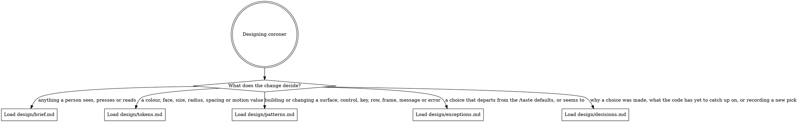

# coroner design

*Audience: coding agents changing how coroner looks or reads to people, and the maintainer
who sets its design direction.*

`design/` holds coroner's design direction: how the HTML and SVG exports, the terminal
viewer and picker, the forms, command output and the docs site look, move and read. The
code holds every value; these pages hold the intent and point at where each value lives.
[`CONTEXT.md`](../CONTEXT.md) defines the domain words they use, such as event, source,
gap and overlay.

## Routing

Read the digraph as a checklist, not a single path. Load every file whose edge matches the
change before you design or style that part.

## Updating design/

These rules hold whether or not you use `/taste`, the maintainer's Claude Code design
skill, whose `init`, `mockup` and `review` commands read and write these files.

- **A token:** change it at its source, which [`tokens.md`](tokens.md) names. Never copy a
  value into these pages; update `tokens.md` only when a role moves to a new home.
- **A new decision:** add a dated entry to [`decisions.md`](decisions.md). If it changes
  how something is built, update [`patterns.md`](patterns.md) in the same change.
- **A deliberate departure from the `/taste` defaults:** record it in
  [`exceptions.md`](exceptions.md) with what it departs from and why.
- **Code that catches up with a decision:** remove its item from the open list in
  `decisions.md`.
- **A new page:** add an edge to the digraph above, and add the page to
  [`rules/documentation.md`](../rules/documentation.md).

The floors (contrast, focus, target size, reduced motion, 200% zoom, colour never the only
signal) are not design choices and never appear in `exceptions.md`. A floor the code
misses is an open item in `decisions.md` until it is fixed.
