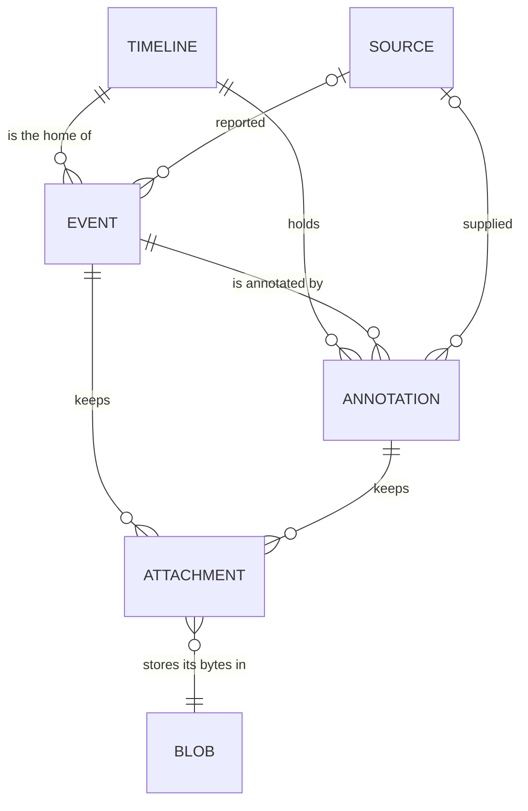

# Data model

*Audience: people who want to understand what coroner stores and why its records fit
together the way they do.*

coroner keeps investigations in one SQLite file: timelines, the events on them, the
annotations and attachments that back those events up, and the sources they came from.
This page explains how those records relate and the choices behind them, then gives the
glossary coroner uses for every name in its commands, JSON and docs.

## How the records relate



### A timeline contains events

A timeline is one investigation's chronology, with a unique name such as `mongo-outage`, a
title, and refs: the issue-tracker keys or URLs it belongs to, kept as written.

Each event belongs to exactly one timeline, its home. An event is a claim about the past
as a source reported it, so it lives where the investigation that recorded it lives. To
read several investigations side by side, such as a database failover and the checkout
latency it caused, you overlay their timelines. An overlay is a query, not a record: it
merges the timelines' events into one chronology and changes none of them.

```sh
coroner event list -t mongo-failover -t checkout-latency
```

Because an overlay never copies or moves an event, an event cannot drift out of step with
a second copy of itself, and deleting one timeline never touches another.

### Annotations back events up

An annotation is material attached to an event, or to the whole timeline when it concerns
no single event. Its kind says what it holds: `evidence` for raw material kept verbatim,
such as a log line or a chat message, and `comment` for an investigator's commentary.

Evidence and commentary are one entity with a kind, rather than two, because they attach
the same way, list together under their event and export as one record type. The kind
keeps them apart where it matters: an evidence body is the source's words, and a comment
is yours.

An annotation has no time of its own on the chronology. Only events are placed in time, so
what happened stays separate from what someone later found or thought about it.

### Sources, tags and refs

A source is the system, service or person an event or annotation came from, such as
`slack` or `db-2/mongod`. Sources are global to the database rather than owned by a
timeline, and naming a new one in `--source` creates it. The same `db-2/mongod` then means
the same thing on every timeline, which is what lets `coroner source list` count its use
and an export match sources across databases by name.

A tag is a free lowercase keyword on an event, such as `election`. A colon marks a shared
convention, as in `phase:detect`. Tags carry no schema: agree on the conventions you need
within your team.

### Attachments and blobs

An attachment is a file, such as a screenshot, kept with one event or annotation. Its
bytes are a blob, stored once under their SHA-256 in the blob directory beside the
database, so attaching the same screenshot twice keeps two attachments and one copy of the
bytes. An export carries each attachment's metadata and hash, and copies the files beside
it when it writes into a directory.

### IDs and seqs

Every record has an ID, a UUIDv7: unique across every database, so an import keeps each
record's ID and a colleague's export merges into yours without renumbering. A UUIDv7 also
starts with the time it was made, so IDs made later sort later.

People do not type UUIDs. Each event also gets a seq when it is added: the next value of
its timeline's counter, shown as `#12`. The counter only increases, so a deleted event's
seq is never reused, and `#12` in last week's chat message still means the event it meant
then, or no event at all.

## Glossary

These are the names coroner uses in its commands, flags, JSON and docs. Each entry lists
the words to avoid for the same idea. The glossary is the repository's
[`CONTEXT.md`](https://github.com/macintacos/coroner/blob/main/CONTEXT.md), word for word.

### The record

**Timeline**: The named chronology of one investigation, usually tied to its refs.

_Avoid_: incident, investigation, case

**Event**: Something that happened at a moment or over an interval, as a source reported
it. It is a claim about the past, even when it only comes from someone's memory.

_Avoid_: entry, marker, note

**Annotation**: Material attached to an event, or to the whole timeline when it concerns
no single event. It has no place of its own in the chronology.

_Avoid_: note

**Evidence**: An annotation that carries raw material verbatim, such as a log line or a
chat message.

**Comment**: An annotation that carries an investigator's commentary.

**Attachment**: A file, such as a screenshot, kept with one event or annotation. Identical
files attached twice are two attachments sharing one blob.

_Avoid_: upload, image

**Blob**: The bytes of an attachment, stored once under their SHA-256 in the blob
directory beside the database.

_Avoid_: object, asset

**Source**: The system, service or person an event or annotation came from, such as
`slack` or `db-2/mongod`.

_Avoid_: process, origin, channel

**Tag**: A free lowercase keyword on an event. A colon marks a shared convention, as in
`phase:detect`.

_Avoid_: label

**Ref**: An issue-tracker key, such as `OPS-42`, or a URL a timeline belongs to, kept as
written. A timeline can have many.

_Avoid_: link, ticket

**Author**: The person who added an event or annotation, which is not necessarily its
source.

_Avoid_: creator, owner, user

### Time

**Occurred at**: When an event happened, or when its interval started.

_Avoid_: timestamp, time, event time

**Ended at**: When an interval ended. An event without one happened at a single moment.

_Avoid_: end time, duration

**Created at**: When a record was first written into coroner. It never decides the order
of events.

_Avoid_: recorded at, observed at

**Updated at**: When a record was last changed in coroner.

**Occurred raw**: When an event happened, exactly as it was given, before coroner resolved
it into an occurred at.

_Avoid_: original time, input time

**Precision**: How exact an occurred at is, from a day down to a nanosecond. A coarse
event stands for the start of its window, so "10:15" comes before every event at 10:15 and
some seconds.

_Avoid_: resolution, granularity

**Approximate**: Marks an occurred at as a guess, as in "around 10:15".

_Avoid_: fuzzy, uncertain

**Gap**: A stretch of time between events that no event covers, often one the
investigation still has to explain.

_Avoid_: hole, blank

### Finding things

**Seq**: The permanent per-timeline counter value an event gets when it is added, shown as
`#12`. It is never reused.

_Avoid_: index, number, ID

**Current timeline**: The timeline `coroner timeline use` stores; a command acts on it
when neither `-t` nor `CORONER_TIMELINE` names one.

_Avoid_: active timeline, context

**Overlay**: Several timelines read together as one chronology, without changing any of
them.

_Avoid_: merge, combine

## Prior art

- Grafana calls the time-placed item itself an annotation. In coroner that item is an
  event, so the two meanings cannot collide.
- lnav uses annotation for output that scripts generate. A coroner annotation is added by
  a person or an agent.
- taskwarrior's annotations are timestamped notes attached to a task: the same shape as
  coroner's, and the reason annotation was kept over note.
- In AWS incident timelines, `eventType: Note` is itself a timeline item. A coroner
  annotation never sits on the time axis by itself.
- Source replaces process, the word in coroner's original brief, which suggested an
  operating-system process.
- Timeline was chosen over incident (not every investigation is an incident, and one
  incident can need several timelines), investigation (heavier) and case (a ticketing or
  legal connotation).
