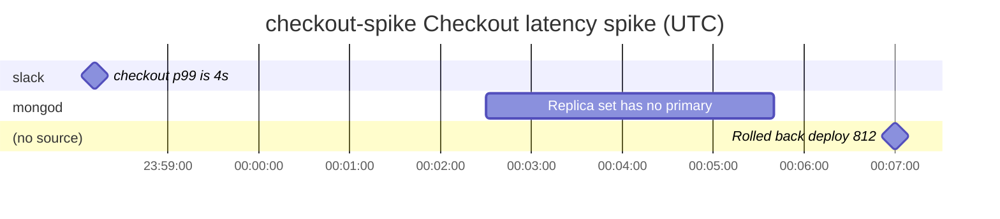

# coroner

*Audience: engineers deciding whether coroner fits the way they investigate incidents.*

coroner is a command-line tool for building root-cause investigation timelines. You name a
timeline for an incident, add timestamped events as you find them in logs, chat and
people's accounts, and export the timeline to share what happened and when. Your timelines
live in one SQLite file on your machine; an export is what you share.

coroner is pre-0.1: commands, flags and the database schema can change without notice.

## Install

```sh
go install github.com/macintacos/coroner@latest
```

[Install coroner](how-to/install.md) covers Homebrew, release archives, shell completions
and uninstalling.

## A 30-second demo

Start a timeline for the incident, make it the current one so later commands act on it,
add what you know, and export it as a Mermaid diagram:

```console
$ coroner timeline create checkout-spike --title "Checkout latency spike" --ref INC-4821
Created timeline `checkout-spike`.
Next: coroner timeline use checkout-spike
      coroner event add -t checkout-spike <text>
$ coroner timeline use checkout-spike
Now using timeline `checkout-spike`.
$ coroner event add "checkout p99 is 4s" --at 2026-09-10T23:58:12Z --source slack
Added event #1 to timeline `checkout-spike` at 2026-09-10T23:58:12Z (+00:00 local: 23:58:12)
$ coroner event add "Replica set has no primary" --at 2026-09-11T00:02:30Z --ended 2026-09-11T00:05:40Z --source mongod
Added event #2 to timeline `checkout-spike` at 2026-09-11T00:02:30Z (+00:00 local: 00:02:30), ended 2026-09-11T00:05:40Z (+00:00 local: 00:05:40)
$ coroner event add "Rolled back deploy 812" --at 2026-09-11T00:07:00Z
Added event #3 to timeline `checkout-spike` at 2026-09-11T00:07:00Z (+00:00 local: 00:07:00)
$ coroner timeline export --format mermaid > timeline.mmd
```

`timeline.mmd` draws the incident with a section per source. An event added with `--ended`
is a bar; every other event is a milestone:



The same timeline also exports as JSON, JSONL, Markdown, a standalone HTML page and an SVG
picture.

## Where to go next

- [Tutorial](tutorial/index.md): learn coroner by building a timeline from start to
  finish.
- [How-to guides](how-to/index.md): steps for a task you already have in mind.
- [CLI reference](reference/cli/coroner.md): every command, flag and help topic, generated
  from coroner itself.
- [Export format](reference/export-format.md): the JSON an export writes, for scripts and
  importers.
- [Explanation](explanation/index.md): why coroner works the way it does.
