# Documentation rules

*Audience: coding agents whose change `AGENTS.md` routes here.*

[`AGENTS.md`](../../AGENTS.md) routes a change to the rules it needs. This file is its
mirror for docs: it maps every doc coroner ships or will ship, and decides which ones a
change updates. Read the digraph as a checklist, not a single path:
**update every doc whose edge matches**. A box marked "not in the repo yet" names the
issue that will land that doc. Until it lands there is nothing to edit: skip the box, and
never create its file early. That issue completes the entry here
([§ The maintenance rule](#the-maintenance-rule)).

## Routing

```graphviz
digraph coroner_docs_router {
    "Changing documentation" [shape=doublecircle];
    "Which doc does the change affect?" [shape=diamond];

    "Edit README.md" [shape=box];
    "Edit AGENTS.md" [shape=box];
    "Edit docs/rules/*.md" [shape=box];
    "Edit docs/contributing/command-checklist.md" [shape=box];
    "Edit docs/contributing/migrations.md" [shape=box];
    "Edit docs/contributing/releasing.md" [shape=box];
    "Edit .claude/skills/release-coroner/SKILL.md" [shape=box];
    "Edit docs/how-to/install.md" [shape=box];
    "Edit .github/pull_request_template.md" [shape=box];
    "Edit internal/cli/testdata/script/contract/README.md" [shape=box];
    "Edit internal/export/html/vendor/README.md" [shape=box];
    "Edit CONTEXT.md" [shape=box];
    "Edit STABILITY.md" [shape=box];
    "Edit the docs site: docs/ and zensical.toml" [shape=box];
    "Regenerate docs/reference/cli/" [shape=box];
    "Edit docs/reference/export-format.md" [shape=box];
    "Edit docs/reference/configuration.md" [shape=box];
    "Edit internal/cli/topics/*.md" [shape=box];
    "Edit skills/coroner/ (SKILL.md and references/)" [shape=box];
    "Edit design/" [shape=box];

    "Changing documentation" -> "Which doc does the change affect?";
    "Which doc does the change affect?" -> "Edit README.md" [label="the human front door: what coroner is, install, installing the agent skill, development setup, project status, license; install and status also appear on docs/index.md, the site's landing page"];
    "Which doc does the change affect?" -> "Edit AGENTS.md" [label="what coroner is, the mise tasks, hk hooks and what CI runs, the routing digraph, where things live, the repository rules"];
    "Which doc does the change affect?" -> "Edit docs/rules/*.md" [label="a rule file for one area, loaded on demand from AGENTS.md; this map is one"];
    "Which doc does the change affect?" -> "Edit docs/contributing/command-checklist.md" [label="clig.dev rules for commands, flags, output and errors, or the verb glossary"];
    "Which doc does the change affect?" -> "Edit docs/contributing/migrations.md" [label="the migration rules, the release fixture databases and their procedure, or a deferred migration gap"];
    "Which doc does the change affect?" -> "Edit docs/contributing/releasing.md" [label="how a release is cut: the tap and its token, the release tasks, the release workflow, .goreleaser.yaml, the release flow /release-coroner runs, or the steps before and after a tag"];
    "Which doc does the change affect?" -> "Edit .claude/skills/release-coroner/SKILL.md" [label="the release flow, or a subcommand, flag, JSON key or error code of internal/tools/release"];
    "Which doc does the change affect?" -> "Edit docs/how-to/install.md" [label="how coroner is installed, upgraded or removed, what a release archive holds, or the macOS signing decision"];
    "Which doc does the change affect?" -> "Edit .github/pull_request_template.md" [label="what every pull request confirms"];
    "Which doc does the change affect?" -> "Edit internal/cli/testdata/script/contract/README.md" [label="what the contract scripts pin and how, what a diff under contract/ means, and the export round trip in internal/cli/roundtrip_test.go"];
    "Which doc does the change affect?" -> "Edit internal/export/html/vendor/README.md" [label="the vendored vis-timeline: its version, checksum, licence or update steps"];
    "Which doc does the change affect?" -> "Edit CONTEXT.md" [label="domain vocabulary: a new or renamed noun, repeated word for word in docs/explanation/data-model.md"];
    "Which doc does the change affect?" -> "Edit STABILITY.md" [label="what is a contract, format_version bumps, deprecation windows"];
    "Which doc does the change affect?" -> "Edit the docs site: docs/ and zensical.toml" [label="user-visible behaviour: the landing page, tutorial, how-to guides, reference and explanation pages, or a page added to or moved in the site's nav"];
    "Which doc does the change affect?" -> "Regenerate docs/reference/cli/" [label="a command, flag or help topic changed: regenerate, never hand-edit"];
    "Which doc does the change affect?" -> "Edit docs/reference/export-format.md" [label="the export envelope, a canonical object's keys, the JSONL stream and its record order, the encoding rules or the evolution rules"];
    "Which doc does the change affect?" -> "Edit docs/reference/configuration.md" [label="a config file key, its type or default, the config file or database precedence, what the file rejects, or the blob directory rule"];
    "Which doc does the change affect?" -> "Edit internal/cli/topics/*.md" [label="terminal help topics: time input, output formats, exit codes, environment variables, each also a published reference page, so its title and structure show on the site"];
    "Which doc does the change affect?" -> "Edit skills/coroner/ (SKILL.md and references/)" [label="a command, flag, JSON key, exit code or experimental surface the agent skill or its references name changed"];
    "Which doc does the change affect?" -> "Edit design/" [label="the design direction: a colour, face, radius or motion value moving to a new home, a design decision, a departure from the /taste defaults, or code catching up with an open item"];
}
```

## The doc landscape

- **[`README.md`](../../README.md)** (human-facing) — the front door: what coroner is,
  install, installing the agent skill, the development tasks and CI, project status, and
  the license, which points at `LICENSE`.
- **[`AGENTS.md`](../../AGENTS.md)** (agent-facing) — the router: what coroner is, the
  `mise` tasks, `hk` hooks and what CI runs, the routing digraph, where things live, and
  the repository rules. `CLAUDE.md` is exactly `@AGENTS.md` so Claude Code reads it
  through the import; it never gains content of its own.
- **`docs/rules/*.md`** (agent-facing) — on-demand rule files, one per area, each reached
  from an edge in `AGENTS.md`'s digraph.
- **[`docs/contributing/command-checklist.md`](../contributing/command-checklist.md)**
  — the [clig.dev](https://clig.dev/) rules with stable IDs (cite them as "violates
  OUT-3") and the verb glossary.
- **[`docs/contributing/migrations.md`](../contributing/migrations.md)** (humans and
  agents) — the migration policy, the fixture database each release commits and how to add
  it, and the migration gaps deferred so far.
- **[`docs/contributing/releasing.md`](../contributing/releasing.md)** (maintainers) — the
  releasing guide: the one-time tap and token setup, releasing with `/release-coroner`
  (the gates it runs, the annotated tag carrying the release notes), recovery and
  rebuilding a tag, and the checks after the release.
- **[`.claude/skills/release-coroner/SKILL.md`](../../.claude/skills/release-coroner/SKILL.md)**
  (the maintainer's agent) — the `/release-coroner` skill that runs a release through
  `internal/tools/release`. It and `releasing.md` describe the same flow, so they change
  together, and both change with the tool's subcommands, JSON keys and error codes.
- **[`docs/how-to/install.md`](../how-to/install.md)** (human-facing) — installing,
  upgrading and removing coroner with `go install`, Homebrew or a release archive, what an
  archive holds, and the macOS signing decision.
- **[`.github/pull_request_template.md`](../../.github/pull_request_template.md)** — the
  checkbox that makes a pull request cite the checklist IDs it was checked against, and
  the contract section that makes it state a contract change's stability.
- **[`internal/cli/testdata/script/contract/README.md`](../../internal/cli/testdata/script/contract/README.md)**
  (humans and agents) — what the contract scripts pin and how, that a diff under
  `contract/` is a contract change, and the export round trip in
  `internal/cli/roundtrip_test.go`.
- **[`internal/export/html/vendor/README.md`](../../internal/export/html/vendor/README.md)**
  (anyone updating the library) — the vis-timeline version the HTML export embeds, the
  committed file's checksum and licence, and how to update it.
- **[`CONTEXT.md`](../../CONTEXT.md)** — the vocabulary glossary for names in code, flags,
  JSON and docs. Past its glossary's introduction,
  [`docs/explanation/data-model.md`](../explanation/data-model.md) ends with this file
  from its Language section on, word for word, and a spec in `internal/timeline` fails
  when they differ, so a glossary change edits both.
- **[`STABILITY.md`](../../STABILITY.md)** (anyone who runs coroner from a script, an
  agent or an importer, and anyone who changes a command, flag, environment variable or
  JSON output) — what counts as a contract, the tiers, what is breaking, how a contract
  change is classified, and the deprecation mechanics. Help topics, the pull request
  template and the contract README link to it for anything beyond a one-line summary.
- **The docs site** (human-facing) — every file under [`docs/`](../) but these rule files,
  which `zensical.toml`'s `exclude_docs` leaves out, built by Zensical with
  `mise run docs:build` from [`zensical.toml`](../../zensical.toml), whose `nav` lists the
  pages, and deployed to GitHub Pages when a `v*` tag is pushed. The
  [landing page](../index.md) says what coroner is and demos it; `tutorial/`, `how-to/`,
  `reference/`, `explanation/` and `contributing/` are its Diátaxis sections.
  [The tutorial](../tutorial/first-timeline.md) and
  [the how-to guides](../how-to/index.md) are in those sections and the nav
  (`docs/how-to/install.md` keeps its own entry).
  [The reference index](../reference/index.md) lists the reference pages: the export
  format, the help topic pages docgen writes under `reference/cli/`, which the nav lists
  as the exit codes, environment variables, time input and output formats pages, and
  [the configuration page](../reference/configuration.md).
  [The explanation pages](../explanation/index.md) cover the data model and its glossary,
  timestamps and time zones, and the design principles. The examples test fails when a
  `coroner` line in the shell code blocks of any page under `docs/` stops parsing, so a
  changed command or flag updates those pages in the same change. The output shown under a
  `console` prompt is pasted from real runs and is not checked, so a change to a command's
  text output updates it on those pages in the same change. A page links a file outside
  `docs/`, or under `docs/rules/`, by its GitHub URL, since a relative one breaks on the
  site and `mise run docs:build` does not catch it. The export schema is the exception:
  `mise run docs:build` copies it into the site, pages link that copy as
  `/coroner/schema/export-v1.schema.json`, under the path of `zensical.toml`'s `site_url`,
  and the build fails when a page links a file under `/coroner/schema/` it did not copy.
- **[`docs/reference/cli/`](../reference/cli/)** (human-facing) — the CLI reference, one
  page per command and per help topic, generated from the commands and topics by
  `go run ./internal/tools/docgen` and checked for drift by `mise run lint`. Never
  hand-edited. The help topic pages are also the site's reference pages for those topics,
  so the terminal and the site never disagree.
- **[`docs/reference/export-format.md`](../reference/export-format.md)** (anyone reading
  or writing coroner's JSON: people with jq, scripts, agents, importers) — the export
  envelope, every key of the canonical objects, the JSONL stream and its record order, the
  encoding rules and the evolution rules. Its machine-readable twin,
  `schema/export-v1.schema.json`, is generated from the `internal/export` types by
  `go run ./internal/tools/schemagen` and never hand-edited.
- **[`docs/reference/configuration.md`](../reference/configuration.md)** (anyone setting
  coroner's defaults for their machine, by hand or from a script) — where the config file
  lives, its keys with their types and defaults, the precedence of flags, environment
  variables, the config file and the database, what the file rejects, and the blob
  directory rule. A spec in `internal/config` fails when the page misses a key the config
  file accepts, so a new config key updates it in the same change.
- **[`internal/cli/topics/*.md`](../../internal/cli/topics/)** (humans and agents at the
  terminal) — the help topics `coroner help <topic>` prints as-is, and the source of their
  CLI reference pages, which are also the site's Exit codes, Environment variables, Time
  input and Output formats pages, so a topic's title or structure changes a published
  reference page. Specs pin the `exit-codes` table and the `environment` variables to the
  code.
- **[`skills/coroner/SKILL.md`](../../skills/coroner/SKILL.md)** (coding agents that drive
  coroner) — the Agent Skill: the rules for running coroner from an agent and a recipe per
  investigation step, with `references/jsonl-events.md` for `event add --from-file`
  records and `references/log-sources.md` for reading log and Slack times. It teaches only
  stable surfaces and points to `coroner help reference` for the rest.
  `coroner agent skill` prints the copy embedded in the binary, and the examples test
  fails when a `coroner` line in its shell code blocks, or its references', stops parsing.
  Nothing checks the JSON keys, exit codes or experimental list it names, nor the facts it
  shares with [adding log lines](../how-to/add-log-lines.md),
  [capturing Slack messages](../how-to/capture-slack-messages.md) and
  [the export format's Event](../reference/export-format.md#event), so a change to any of
  them updates the skill by hand. [The how-to](../how-to/use-with-ai-agents.md) documents
  installing it.
  [`.claude-plugin/marketplace.json`](../../.claude-plugin/marketplace.json) offers it as
  a plugin; `README.md` and the how-to repeat its plugin and marketplace names, so a
  rename there updates both.
- **[`design/`](../../design/README.md)** (coding agents changing how coroner looks or
  reads to people, and the maintainer who sets its design direction) — the design
  direction for the exports, the viewer, picker and forms, command output and the docs
  site: the brief, where each design value lives, the patterns, the departures from the
  `/taste` defaults, and the decision log with what the code has yet to catch up on. It
  sits at the repo root rather than under `docs/`, which publishes every file outside
  `docs/rules/`, because the `/taste` skill reads it there. Its pages point at values in
  the code and never copy them, so moving a value updates `design/tokens.md`, and code
  that closes an open item removes it from `design/decisions.md`.

## Audience, stated at the top of every new doc

Every new doc states its audience in its first line under the title (rumdl's MD041 needs
the title first), so a reader knows in one line whether it is written for them. Generated
docs such as `docs/reference/cli/` are exempt; their landscape entry names the audience.

`README.md` and the docs site are **human-facing**. `AGENTS.md` and everything under
`docs/rules/` are **agent-facing**. A new doc outside both groups names its audience when
it lands.

Diagrams follow the same split, **deliberately**: human-facing docs use **mermaid**, which
GitHub and the docs site render, and agent-facing docs use **graphviz**, which agents read
as text. This is not an inconsistency to reconcile; never convert one to the other.

## Prose passes: use `/doc-coauthoring`

Substantive prose passes, such as a new doc or a restructured section, go through the
`/doc-coauthoring` skill at `~/.claude/skills/doc-coauthoring/SKILL.md`. It walks the
audience, the reader's goal, the structure, and a readability pass. Follow that file
directly; it is not paraphrased here.

## The maintenance rule

Documentation drifts when a map and the thing it maps change in separate pull requests.
So, **in the same change**:

1. **When one of these is added, removed, or renamed:**
   - a doc updates its box and landscape entry here, and a rule file under `docs/rules/`
     also adds or updates its edge in `AGENTS.md`'s digraph;
   - a `mise` task, `hk` hook or CI workflow step updates `AGENTS.md` § How to work here
     and every doc that names it, such as `README.md`'s Development section, and so does a
     change to what one runs;
   - a generated artifact adds its path and how to regenerate it to `AGENTS.md` Rule 2,
     and a box and landscape entry here when it is a doc, like the CLI reference.
2. **Landing something marked "not in the repo yet"** removes every marker for it (grep
   for its path and its issue ID; a marker inside a digraph appears on both the box and
   its edge) and turns the path mention into a link, outside code blocks.
3. **An area gets rules only once it has code.** An area is a top-level package under
   `internal/` or a top-level directory such as `skills/`. The first issue with rules for
   an area that an agent would otherwise get wrong adds `docs/rules/<area>.md` and the
   `AGENTS.md` edge that loads it.
4. **A new doc** states its audience and uses that audience's diagram tool
   ([§ Audience](#audience-stated-at-the-top-of-every-new-doc)).
5. **A substantive prose pass** goes through `/doc-coauthoring`
   ([§ Prose passes](#prose-passes-use-doc-coauthoring)).

A doc that exists without a place on this map is a doc no one will find.
